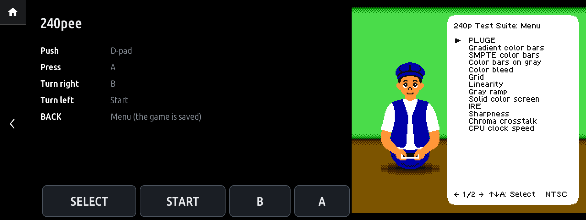
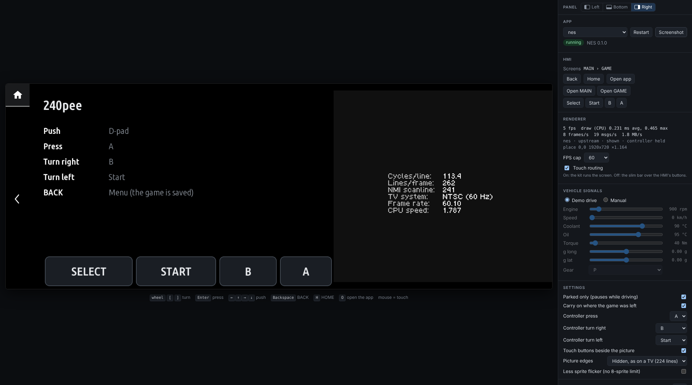

# NES for iDrive 7

**Nintendo Entertainment System games on the BMW iDrive 7 (MGU) head unit itself.** The [FCEUmm](https://github.com/libretro/libretro-fceumm) emulator runs inside an app on the head unit, built on the [idrive7-apps](https://github.com/cauliflowermossgrape/idrive7-apps) kit the way its Doom app is: 60 frames a second, the console's picture shown three times as big, pixel for pixel, played with the iDrive controller and buttons on the touchscreen. For when you're parked.

> **Status: proof of concept, not yet run on a car.** Everything below works in the emulator on a PC and under Node 8, the Node.js the head unit runs apps on. How it behaves on the head unit's processor, and within its limits for apps, is what the first test on a car has to show. See [What still needs a car](#what-still-needs-a-car).

> **Your iDrive 7 head unit must be rooted to use this.** BMW's head unit only runs apps BMW installs, so the app can only be installed on a unit you have root (SSH) access to, [from the MGU Store](#from-the-mgu-store) or [with the kit's installer](#with-the-kits-installer). Rooting is done with the community tool [idrive7-8-ssh-root](https://github.com/cauliflowermossgrape/idrive7-8-ssh-root). It can wipe the head unit's coding, delete BMW Digital Key pairings and, at worst, brick the unit. Read [Rooting your head unit](#rooting-your-head-unit) before you start. The emulator on a PC needs no root.



*The [240p Test Suite](https://github.com/pinobatch/240p-test-mini) (free software by Artemio Urbina and Damian Yerrick) in the app, as the head unit's 1920 x 720 screen would show it.*

**No games are included.** The app runs `.nes` files you supply. This is an independent community project. It is not affiliated with or endorsed by BMW or Nintendo. All trademarks belong to their owners.

---

## What it does

### Games

- The app runs `.nes` files (iNES format) from two places:
  - **`app/roms/` on your PC.** The build for the kit's installer packs the folder into the app, so the games install with it. Git ignores them, and the package the MGU Store installs never has any.
  - **`roms/` in the app's data folder on the head unit** (`/var/opt/public/oap/oap_<uid>/data/roms/`; the app's menu names the folder while it has no game, and its log at each start). Files copied there show up in the menu within a few seconds, without a rebuild.
- **The main menu** is one of the head unit's own lists: *Continue*, *Restart*, the games by name (ten to a page, *More games* for the next), and every setting.
- **FCEUmm's compatibility:** the complete libretro core is built in, with all its cartridge mappers. One player; no light gun or other accessories.

### Controls

| | |
|---|---|
| Push the controller up / right / down / left | D-pad, held while pushed |
| Press it | A, held while pressed |
| Turn it right, one click | a tap of B (several clicks: that many taps) |
| Turn it left, one click | a tap of Start |
| SELECT, START, B, A on the touchscreen | a tap of that button |
| BACK | the main menu; the game is saved |

- **Press and the two turn directions** can be given other buttons in the settings.
- **The touch buttons** are the head unit's own bar buttons, which stay under the picture. The app draws them where the head unit has them and moves the picture to the right to make room. With *Touch buttons beside the picture* off, the picture sits in the middle.
- **While a game runs it has the controller to itself,** through the controller gate the kit's installer sets up. BACK, MENU and the touchscreen always work.
- **The controller is not a gamepad:** one direction at a time, one held button, taps for the rest. That is fine for menus, puzzle and turn-based games, and hard for platformers. See [Known gaps](#known-gaps).

### Saves

- **Leaving the game saves it:** BACK, MENU, a popup or call, driving off, the app closing. It is also saved every 30 seconds while you play.
- ***Continue*** and picking the game again carry on from there. ***Restart*** starts the game from power-on.
- **A cartridge's battery memory** (the game's own save) is kept separately and survives a restart.
- Both are in `saves/` in the app's data folder, so they survive reinstalling the app, but not the installer's `restore`.
- **A crash loses them.** When an app exits unexpectedly, the head unit empties its data folder, and uninstalls the app the second time (idrive7-apps' README, "Crash handling is harsh"). That takes the saves and the games copied to the data folder with it, so keep your games on the PC too.

### Settings

| Setting | Choices (default first) |
|---|---|
| Parked only (pauses while driving) | on, off |
| Carry on where the game was left | on, off |
| Controller press | A, B |
| Controller turn right | B, A, Start, Select, Nothing |
| Controller turn left | Start, Select, B, A, Nothing |
| Touch buttons beside the picture | on, off |
| Picture edges | Hidden, as on a TV (224 lines); Shown (240 lines) |
| Less sprite flicker (no 8-sprite limit) | off, on |

### Parked only

With *Parked only* on, the game stops and saves once the car moves faster than 3 km/h. The app goes back to its menu, and the menu says why. *Continue* carries on when the car stands again.

## How it works

```
 app/main.js            the screens (the idrive7-apps kit: menu, GPU renderer, settings), the
     │                  60 Hz pacing, saving, the parked check
     ├─ app/library.js    the games (the build's pack, the data folder) and the saves
     ├─ app/controls.js   iDrive controller and touch buttons -> the NES pad
     │
 app/nes-core.js        runs the emulator: ROM in, pad in, one frame at a time, picture out
     │
 app/nes.wasm           FCEUmm + core/mgu_libretro.c, compiled to WebAssembly (core/build.sh)
     │
 the kit's GPU renderer (mgu-renderd)  ──▶  the picture as a 256 x 224 image, drawn 3 x 3
```

- **The emulator runs inside the app's own Node.js process,** as the kit's Doom does. The head unit's Node 8 only knows the first version of WebAssembly, so the core is built for that.
- **Each frame is handed to the kit's GPU renderer as a pixel image** and scaled by whole pixels. Without the renderer the game shows at twice its size in the head unit's own image, a few pictures a second.
- **No sound.** Nothing on the head unit takes an app's samples yet. The emulator produces them; they are dropped.
- More on the build of the core, and what it was checked against, in [`core/README.md`](core/README.md).

## Try it in the emulator

You need **Node.js 18+**, **Python 3** and **git**. No car, no head unit and no BMW software are needed. There are no npm packages to install.

```bash
git clone --recursive https://github.com/clucraft/nes-idrive.git
```

```bash
cd nes-idrive
```

Copy a `.nes` file or two into `app/roms/`, then:

```bash
npm run emu
```

Then open http://localhost:8077.



*The emulator page. On the screen, the 240p Test Suite's own measurement of the emulated console: NTSC, 60.10 frames a second.*

- **Starting a game:** the main menu's rows are the buttons in the side panel (the emulator doesn't draw the head unit's own lists). The games are the buttons after *Restart*, in the menu's order, by name.
- **Controls:** the arrow keys push the iDrive controller, `Enter` presses it, the mouse wheel and `[` `]` turn it, `Backspace` is BACK. A click on a drawn button is a tap.
- **The first knob click** after the app starts only tells the app where the knob stands, so the first `[` does nothing. On the car the app also asks for the controller's state at start.
- **Side panel:** settings, the app's buttons and its log. The *Speed* slider under *Manual* tries the parked check.
- **Live reload:** saving a file in `app/` rebuilds and restarts the app in about a second. So does a game dropped into `app/roms/`.
- **Saves and settings** are in `vendor/idrive7-apps/preview/emu/clucraft_nes/`; delete that folder to start over.

`npm run setup` (also run by `emu`) does the following:

- applies [`patches/idrive7-apps`](patches/idrive7-apps) to the kit
- links `app/` into the kit as `apps/clucraft_nes`, the app's id
- writes a clearly marked **placeholder** for BMW's SDK, because the kit's build expects one and the emulator never loads it

The patch lets the emulator run on Windows (a named pipe instead of a Unix socket, `python` instead of `python3`). It is the one [boostline-idrive](https://github.com/clucraft/boostline-idrive) carries, unchanged; its diagnostics hook is not used here.

### Tests

```bash
npm test
```

```bash
npm run test:node8
```

Both run without a game, a browser or the kit. They cover:

- the emulator on a small test cartridge the test assembles itself: the picture, pad 1 reaching the game, the cut edges, save states (also into a new instance), files that are no cartridge, and the core's memory never growing
- the controls: push and press held, one tap per knob click, the settings' assignments, touch buttons, a lost release, nothing while the game is stopped
- the games and saves on disk: the build's pack and the data folder, titles, state, battery memory, the game played last
- what the MGU Store reads: `mgu-repo.json`, and the package in `store/` being this `app/` at its version, with no SDK and no game in it

`test:node8` runs them on Node 8.17.0, as the head unit does. It downloads that Node release once from nodejs.org and checks it against the release's checksums.

## Rooting your head unit

**This is required.** The head unit is a Linux computer that runs BMW's apps, but it only installs apps BMW delivers. This app, like every app in the [idrive7-apps](https://github.com/cauliflowermossgrape/idrive7-apps) kit it is built on, is installed over SSH as `root`. So before anything else, your iDrive 7 (MGU) head unit needs root SSH access.

### The rooting tool

**[cauliflowermossgrape/idrive7-8-ssh-root](https://github.com/cauliflowermossgrape/idrive7-8-ssh-root)** turns on the head unit's root SSH service using only the car's ENET diagnostic port and a laptop.

- **Supported units:** it handles iDrive 7 (MGU ID7) and the iDrive 8 BDC3 / BCP units. This app is for **iDrive 7 only**.
- **Its README is the authority.** Follow it, not this summary.

You need:

- an **ENET cable**, wired. The tool's README says WiFi adapters (MHD, bootmod3) can't carry SSH, so they won't do for this step.
- a Windows, macOS or Linux laptop with an OpenSSH client
- the tool's prebuilt Windows `.exe`, or Python 3.9+ to run it from source
- on Windows, the tool run as Administrator
- the ignition on, or the car awake

### The steps

1. **Back up the head unit's coding first.** Flashing wipes it. The tool's README describes doing this with BimmerCode, or with ISTA / E-Sys.
2. **Run the tool's *Flash + Enable* with your VIN.** This is a one-time flash of a small debug image, then SSH is enrolled and made permanent with debug mode off.
3. **Restore your coding** if anything was reset.
4. **Re-pair every BMW Digital Key.** The flash deletes them, and the coding backup doesn't cover them.
5. **Keep the SSH key and the head unit's address** the tool saves in `data/enrollments/<VIN>/`. You need them for the install below:

   | What | File | Installer setting |
   |---|---|---|
   | The key | `id_rsa` | `KEY=` / `-Key` |
   | The address (e.g. `169.254.36.47`) | `connect.txt` | `HU=root@<address>` / `-Ip` |

### Risks and undoing it

- **Risks:** the tool is for your own vehicle, at your own risk. Its disclaimer: flashing can wipe the head unit's coding, delete its BMW Digital Key pairings and, in the worst case, brick the module.
- **Undoing root:** the tool's *Disable* turns SSH off again.
- **Removing the apps:** the kit installer's `restore` takes the apps off and puts the head unit's files back from its backup.

This project isn't affiliated with the rooting tool or its authors, and can't help with rooting problems. Ask in [its issues](https://github.com/cauliflowermossgrape/idrive7-8-ssh-root/issues).

## On a car

There are two ways to install the app. Both need a [rooted head unit](#rooting-your-head-unit).

| | From the MGU Store | With the kit's installer |
|---|---|---|
| On the head unit first | the [MGU Store](https://github.com/robertnisipeanu/mgu-store), with internet | nothing |
| On a PC | nothing | BMW's SDK taken from the unit, then a build |
| Games | copied to the head unit afterwards | packed into the app, or copied afterwards |
| Updates | the Store offers them | build and push again |

### From the MGU Store

The [MGU Store](https://github.com/robertnisipeanu/mgu-store) is an app store for rooted head units that installs apps straight from GitHub repositories. This repository is laid out as one of its sources.

1. **Add the source.** In the Store: Settings → **Add source**, type `clucraft/nes-idrive`, and pick the branch **main**.
2. **Install *NES*** from the Store page. The Store then:
   - downloads the package kept in [`store/`](store) (about 1.2 MB)
   - adds BMW's SDK to it on the head unit, from one of BMW's own apps there
   - installs the controller gate (`mgu-inputgate`) first when it is missing. It comes from idrive7-apps, one of the sources the Store starts with.
3. **Restart the head unit** if the Store shows *Restart pending* (Settings → **Restart head unit**). The controller gate only takes effect then. Until it does, the game still runs, but the head unit acts on the controller as well: a push can open its own menus.
4. **Copy your games to the head unit.** The Store's package has none. Open the app once: its menu names the games folder. Then, with the SSH key and address from the rooting tool:

   ```bash
   scp -i <id_rsa> *.nes root@<address>:/var/opt/public/oap/oap_<uid>/data/roms/
   ```

   This finds `<uid>` without opening the app:

   ```bash
   ssh -i <id_rsa> root@<address> 'grep -l clucraft_nes /var/opt/public/oap/oap_*/source/package.json'
   ```

- **A renderer has to be installed.** The Store's own (mgu-render, installed with the Store unless you left it out) or idrive7-apps' (`idrive7-renderd`) will do. Without one the Store refuses the install and says so.
- **Updates:** a commit here that changes the package in `store/` shows in the Store as an update. It never installs on its own.
- **A car without internet:** the Store can also read a copy of this repository from a USB stick. Its `deploy/mgu-install.js usb-repo <stick> github:clucraft/nes-idrive` makes one.

> **Not tried on a car yet.** The Store route was checked against the Store's published rules for sources ([`docs/PUBLISHING.md`](https://github.com/robertnisipeanu/mgu-store/blob/main/docs/PUBLISHING.md)) and by `npm test`, not by an install.

### With the kit's installer

1. **Get BMW's app SDK from the head unit.** The [idrive7-apps README](https://github.com/cauliflowermossgrape/idrive7-apps#31-get-the-sdk-from-your-unit) explains how to:
   - copy one of BMW's preinstalled apps off the unit over SSH
   - extract the SDK from it into `vendor/idrive7-apps/oap-sdk/` with `kit/tools/extract_sdk.js`, replacing the placeholder
2. **Put your games into `app/roms/`** if you want them installed with the app. They can also be copied to the head unit later (step 5).
3. **Build the package:**

   ```bash
   npm run build:car
   ```

   This writes `dist/clucraft_nes@<version>.mgu`. It refuses to build with the placeholder SDK. The package contains BMW's SDK and your games, so keep it for your own car and never publish it.
4. **Install it** with the kit's installer in `vendor/idrive7-apps`, as its README describes. It also installs the GPU renderer and the controller gate, and the head unit restarts once at the end.
   - Build a car kit with just this app: `python3 kit/tools/make_kit.py clucraft_nes` (`deploy/make-car-kit.sh` packs every app of the kit instead).
   - Push it with `push-to-car.sh` (Linux/macOS) or `push-to-car.ps1` (Windows), using the SSH key and address from the rooting tool:
     - `push-to-car.sh`: `HU=root@<address> KEY=<.../data/enrollments/<VIN>/id_rsa>`
     - `push-to-car.ps1`: `-Key <...\data\enrollments\<VIN>\id_rsa> -Ip <address>`
   - Run its `check` first. It is read-only and lists what `install` would change.
5. **More games later:** copy `.nes` files with `scp` to `/var/opt/public/oap/oap_<uid>/data/roms/`. The installer's `status` lists the apps; the app's log, `clucraft_nes.log` in its data folder, names the folder.

### Either way

**The first game after the app starts** may open a few seconds late: the head unit has to compile the emulator first. The app starts on that in the background as soon as it starts itself.

### Publishing a new version to the Store

For whoever maintains this repository. The Store installs what is committed in `store/`, not `app/`:

1. Raise `version` in `app/app.json`.
2. `npm run build:store` builds the app with the kit and writes `store/clucraft_nes@<version>.tgz`, `store/app.json` and `store/icon.png`. It leaves BMW's SDK and every game out of the package, whatever is in `app/roms/`.
3. `npm test` fails if `store/` is not the `app/` beside it.
4. Commit `store/` with the change and push to `main`.

## What still needs a car

The emulator on a PC draws with the kit's own draw engine and runs the kit's own runtime, and the tests run on the head unit's Node version. Only a car can tell:

- **Speed and memory:** on a PC under Node 8, a frame takes under a millisecond and the app's process holds about 110 MB with a game running (the kit's Doom engine alone, measured the same way: about 165 MB). The head unit's processor is slower, and the app platform stops apps that go over its CPU and memory limits.
- **Smoothness:** whether the game gets exactly one frame for each of the screen's, as it does when the PC test ticks it at 60 Hz.
- **Touch buttons:** whether taps land on the head unit's hidden bar buttons where the app draws them. The positions come from the kit's own model of the screen.
- **The menu:** whether the head unit hides the unused game rows. If it doesn't, they show as "-".
- **The controller:** the gate holding the knob for the game, and the first knob click counting.
- **The MGU Store:** that it lists and installs the app from this repository, and that the app draws through the Store's own renderer as it does through the kit's. mgu-render reads the kit renderer's commands, pixel images and the hold on the controller included. Its README lists the kit's apps drawing under it, and that hold, among what only a car can show.

## Known gaps

- **No sound.**
- **A real gamepad.** The plan is a USB pad (or a 2.4 GHz one with a USB dongle), read by a small helper on the head unit; whether the head unit's kernel has the drivers for one is not known yet. `Controls.setExternal` in [`app/controls.js`](app/controls.js) already takes such a pad's buttons.
- **A PAL game** runs at its 50 frames a second on the 60 Hz screen, so it scrolls less smoothly.
- **iDrive 8:** the picture is centred and the touch buttons are not drawn. Not tested.
- The emulator patch is kept here as a patch file. It belongs upstream in idrive7-apps.

## Repository layout

```
app/                  the head-unit app: app.json, main.js (screens, pacing, saving),
                      nes-core.js (the emulator's runner), controls.js, library.js,
                      nes.wasm (the emulator, built by core/build.sh), icon.png, roms/ (your games)
core/                 the emulator's build: mgu_libretro.c (a libretro frontend for WebAssembly),
                      build.sh, README.md
docs/                 screenshots
patches/idrive7-apps/ the emulator on Windows, applied by tools/setup.js
mgu-repo.json         what the MGU Store reads: the app, what it needs, where its package is
store/                the package the MGU Store installs (no SDK, no games), its app.json and icon;
                      written by tools/build-store.js
test/run.js           tests of the emulator, the controls, the saves and store/ (Node 8 and current)
tools/                setup.js, emu.js, build-car.js, node8.js; build-store.js and tar.js (store/);
                      prebuilt.js (the Store's build step on the head unit: the package is there)
vendor/idrive7-apps   submodule: the MGU app kit, emulator and installer
vendor/libretro-fceumm  submodule: FCEUmm's source, unchanged, at the commit nes.wasm is built from
```

## Licence

GPL-2.0-or-later. See [LICENSE](LICENSE) and [NOTICE](NOTICE).

- The app contains FCEUmm (GPL-2.0-or-later) as `app/nes.wasm`, so the app and this repository are under the GPL. The complete source of `nes.wasm` is here: the `vendor/libretro-fceumm` submodule and `core/`. `core/build.sh` rebuilds it byte for byte.
- The submodules keep their own licences. The idrive7-apps kit is MIT; its GPU renderer and the emulator's draw engine are GPL-3.0-or-later and run as their own programs.
- The package in `store/` is this app with the kit's runtime (MIT), built by the kit. Its source is this repository at the same commit; it carries `LICENSE` and `NOTICE` too.
- BMW's app SDK is BMW's. It is not in this repository, nor in the package in `store/`, and may not be published.
- No games are in this repository, and none may be added to it.
